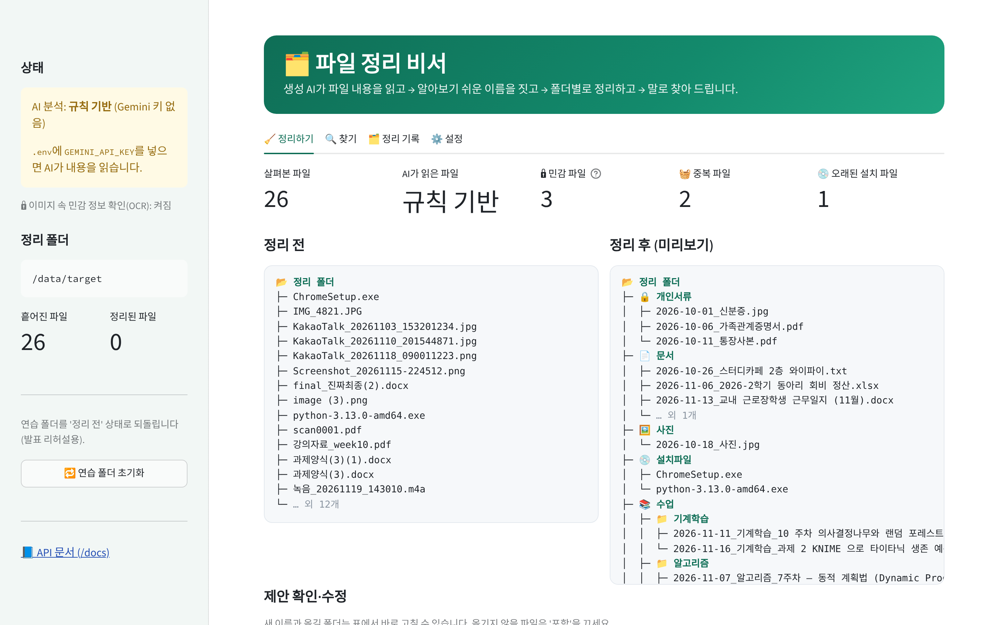
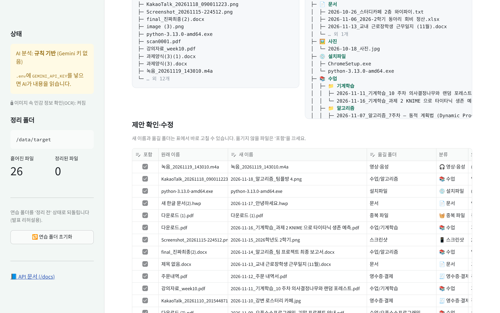
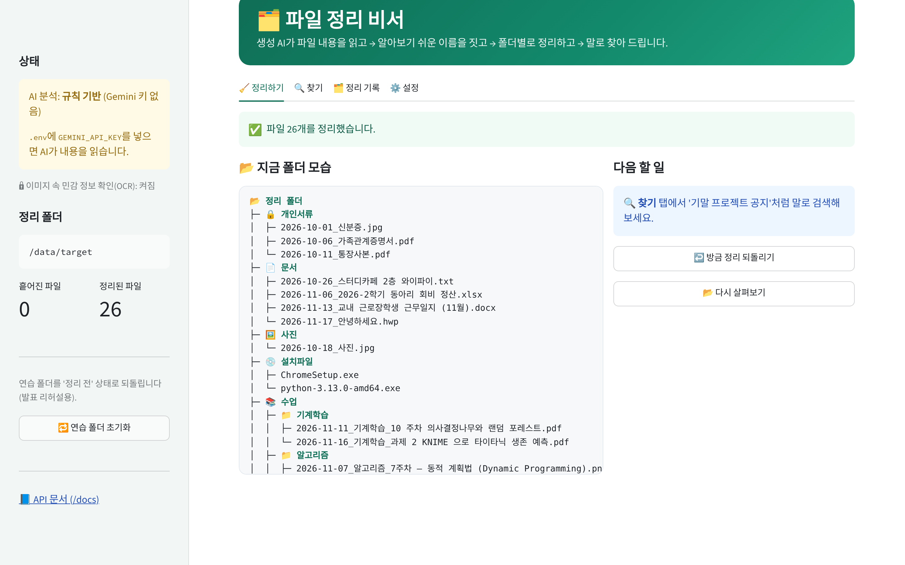
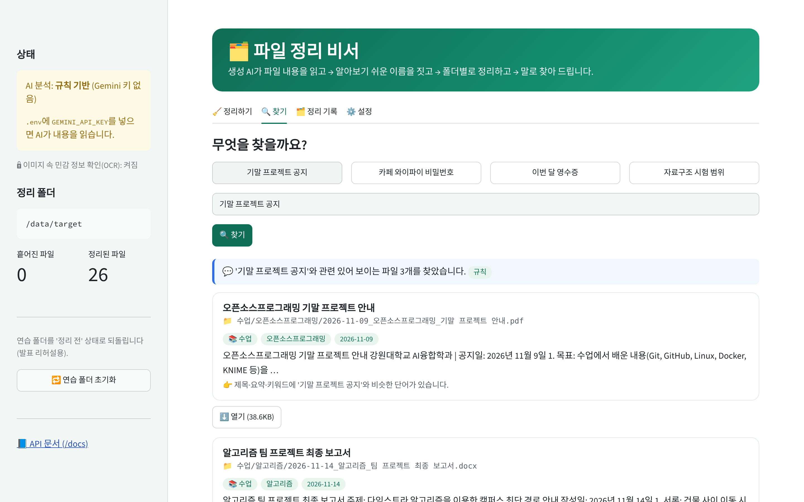
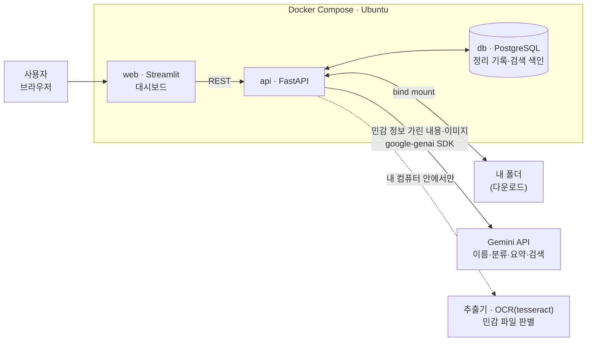

# 🗂️ 파일 정리 비서 (File Secretary)

> 다운로드 폴더에 쌓인 `KakaoTalk_20261103_153201234.jpg`, `다운로드 (7).pdf`, `과제양식(3).hwp`…
> **생성 AI가 파일 내용을 읽고 → 알아보기 쉬운 이름을 짓고 → 폴더별로 정리하고 → 말로 찾아 줍니다.**

| 정리 전 | 정리 후 |
|---|---|
| `다운로드 (7).pdf` | `수업/오픈소스프로그래밍/2026-11-09_오픈소스프로그래밍_기말 프로젝트 안내.pdf` |
| `KakaoTalk_20261103_153201234.jpg` (칠판 사진) | `수업/자료구조/2026-11-03_자료구조_중간고사 범위.jpg` |
| `scan0001.pdf` (가족관계증명서) | `개인서류/2026-10-06_가족관계증명서.pdf` 🔒 내용은 AI에 보내지 않음 |
| `다운로드 (1).pdf` (같은 파일) | `중복 파일/다운로드 (1).pdf` |

## 주요 기능

| 기능 | 설명 |
|---|---|
| **AI 이름 짓기** | PDF·Word·PPT·Excel·**한글(HWP·HWPX)**·이미지 내용을 읽고 `날짜_과목_제목` 형식으로 이름 제안 |
| **폴더 정리** | 수업(과목별)·문서·영수증·사진·스크린샷·개인서류·설치파일 등으로 분류. 내 과목 목록 반영 |
| **미리보기 → 승인** | 정리 전/후 폴더 모습을 먼저 보여 주고, 표에서 이름·폴더를 고친 뒤 승인한 것만 옮김 |
| **되돌리기** | 모든 이동을 기록해 한 번에 원래대로 |
| **리눅스 명령어로 내보내기** | 정리 계획을 `mkdir -p`·`mv -n` 셸 스크립트로 내려받기, 되돌리기 스크립트도 제공 (API `/plans/{id}/script`, `/batches/{id}/script` — 사용자 화면에서는 숨김) |
| **폴더 감시 데몬** | 새 파일이 들어오면 백그라운드에서 미리 AI 분석 → '살펴보기'를 누를 때는 기다리지 않음 |
| **말로 검색** | "교수님이 보낸 기말 프로젝트 공지 찾아줘" → 파일과 요약, 바로 열기. 한 번 AI가 답한 질문은 저장해 두고(예시 질문은 감시 데몬이 미리 준비), 같은 질문은 바로 답함 |
| **개인정보 보호** | 신분증·증명서·통장 사본은 **내용을 AI에 보내지 않음**. 일반 문서도 전화번호·이메일·계좌번호를 가린 뒤 전송 |
| **정리 도우미** | 중복 파일(내용 지문 비교), 오래된 설치 파일 표시 — 지우는 기능은 없음 |

## 화면

> 아래는 Gemini 키 없이 **규칙 기반 모드**로 연습 폴더를 정리한 화면입니다. 키를 넣으면 AI가 내용을 이해해 이름과 요약을 씁니다.

| 정리 전/후 미리보기 | 제안 확인·수정 |
|---|---|
|  |  |
| **정리 결과** | **말로 검색** |
|  |  |

## 동작 구조



1. **살펴보기**: 폴더 맨 위의 파일 목록 → 내용 지문(SHA-256)으로 중복 확인
2. **읽기**: 문서 글자 추출(HWP 5.0은 OLE 구조를 직접 해석), 이미지는 축소 + OCR
3. **보호**: 주민번호·카드·계좌 형식, '가족관계증명서' 같은 단어가 보이면 민감 파일 → AI로 보내지 않음
4. **AI 분석**: 파일 8개씩 묶어 Gemini에 보내고(무료 호출 한도 절약) JSON 스키마로 결과를 받음
5. **이름 만들기**: Windows에서 못 쓰는 문자 제거, 같은 이름은 `(2)` 붙이기
6. **승인 후 이동 → 기록 → 되돌리기 / 검색**

## 빠른 시작 (Docker)

```bash
git clone https://github.com/<아이디>/file-secretary.git && cd file-secretary
cp .env.example .env && chmod 600 .env      # GEMINI_API_KEY, SECRETARY_API_KEY 채우기
docker compose up -d --build
docker compose ps                            # 4개 컨테이너(db·api·watcher·web)가 healthy인지 확인
```

| 주소 | 내용 |
|---|---|
| http://localhost:8501 | 대시보드 |
| http://localhost:8000/docs | 자동 생성 API 문서 (Swagger) |

- 처음에는 **연습 폴더**(`demo/inbox`)가 연결됩니다. **설정** 탭의 **연습 폴더 초기화**를 누르면 지저분한 샘플 파일 26개가 들어갑니다.
- Gemini 키가 없으면 **규칙 기반**(파일 이름·글자·OCR 단서)으로 전체 흐름이 동작합니다. 키를 넣으면 AI가 내용을 이해해 훨씬 자연스러운 이름을 짓습니다.
- Gemini 키 발급: [Google AI Studio](https://aistudio.google.com/) → API 키 만들기 → `.env`의 `GEMINI_API_KEY=`에 붙여 넣고 `docker compose up -d`.

## 내 진짜 폴더 연결하기

> ⚠️ 처음에는 다운로드 폴더를 **복사한 폴더**로 시험해 보세요. 되돌리기가 있지만, 내 파일이니까요.

`.env`의 `HOST_TARGET_DIR`를 바꾸고 다시 시작합니다.

```bash
# Windows (Docker Desktop)
HOST_TARGET_DIR=C:/Users/내아이디/Downloads
# WSL·리눅스 (파일 권한을 위해 APP_UID·APP_GID를 id -u, id -g 값으로)
HOST_TARGET_DIR=/home/내아이디/Downloads

docker compose up -d
```

- 폴더 **맨 위에 흩어진 파일만** 정리합니다. 이미 만든 하위 폴더 안은 건드리지 않습니다.
- 진짜 폴더에서는 '연습 폴더 초기화'가 동작하지 않습니다 (실수 방지).

## Docker 없이 실행 (개발용)

```bash
cd api && python3 -m venv .venv && . .venv/bin/activate
pip install -r requirements-dev.txt
TARGET_DIR=../demo/inbox SAMPLES_DIR=../demo/samples uvicorn app.main:app --reload   # SQLite 사용

# 새 터미널
cd web && pip install -r requirements.txt && streamlit run app.py
```

이미지 속 민감 정보 확인(OCR)을 쓰려면 `sudo apt install -y tesseract-ocr tesseract-ocr-kor`.

## 테스트

```bash
cd api && pytest          # 47개: 추출기(HWP 포함)·민감 정보·이름 규칙·이동/되돌리기·검색·REST API·Gemini 요청 형식
# PostgreSQL로: TEST_DATABASE_URL=postgresql+psycopg://user:pw@localhost:5432/test pytest
```

Gemini 관련 테스트는 **진짜 google-genai SDK가 로컬 가짜 서버로 요청**하게 해서, 요청 형식과 "민감 파일 내용이 요청에 없는지"를 검사합니다.

## REST API

| 메서드 | 경로 | 역할 |
|---|---|---|
| POST | `/api/v1/plans` | 폴더를 살펴보고 정리 계획 만들기 (Create) |
| GET | `/api/v1/plans`, `/api/v1/plans/{id}` | 계획 목록·상세 (Read) |
| PATCH | `/api/v1/plans/{id}/items/{item_id}` | 새 이름·폴더·포함 여부 고치기 (Update) |
| DELETE | `/api/v1/plans/{id}` | 적용 전 계획 취소 (Delete) |
| POST | `/api/v1/plans/{id}/apply` | 계획대로 파일 옮기기 |
| GET / POST | `/api/v1/batches`, `/api/v1/batches/{id}/undo` | 정리 기록 / 되돌리기 |
| GET | `/api/v1/files`, `/api/v1/files/{id}/content` | 파일 색인 / 내려받기 |
| GET | `/api/v1/files/{id}/open?exp=…&sig=…` | 검색 결과 제목을 눌러 브라우저에서 열기 (API 키로 만든 1시간짜리 서명 링크) |
| GET | `/api/v1/search?q=` | 말로 검색 |
| GET | `/api/v1/tree`, `/api/v1/stats` | 폴더 구조·통계 |
| GET / PUT | `/api/v1/settings` | 설정 조회 / 전체 교체 (멱등) |
| POST | `/api/v1/demo/reset` | 연습 폴더 초기화 |

`/health`를 뺀 모든 요청은 `X-API-Key` 헤더가 필요합니다 (`.env`의 `SECRETARY_API_KEY`).

## 강의 내용 활용

| 강의 | 이 프로젝트에서 | 파일 |
|---|---|---|
| 오픈소스 개념 | MIT 라이선스로 공개, 오픈소스 부품 활용(tesseract, hwplib 샘플 — Apache-2.0 표기), 기존 오픈소스 조사·비교 | `LICENSE`, `docs/comparison.md` |
| 리눅스 1 | 정리 계획을 `mkdir -p`·`mv -n` 스크립트로 내보내기(`rm` 없음, `>>` 기록), 파이프(`\|`)·리다이렉션(`>>`)으로 API 결과 가공(`curl \| jq`), `apt`로 tesseract·jq 설치 | `api/app/shellscript.py`, `scripts/*.sh`, `api/Dockerfile` |
| 리눅스 2·3 | **폴더 감시 데몬**(항상 실행되며 새 파일을 미리 분석, `SIGTERM`으로 깔끔하게 종료), bash 스크립트(`#!/bin/bash`, `chmod +x`), `crontab`으로 매일 자동 리포트, `.env`는 `chmod 600`, 사용자 번호(UID)와 파일 권한 | `api/app/watcher.py`, `scripts/daily_report.sh`, `.env.example` |
| 가상화 | CI에서 PostgreSQL 서비스 컨테이너로 통합 테스트·이미지 빌드·Trivy 취약점 검사, 멀티스테이지 Dockerfile, `.dockerignore`, Compose(web·api·db + volume + bridge + **bind mount**), healthcheck, 비root 실행, Docker Hub push | `*/Dockerfile`, `docker-compose.yml` |
| Git 1~3 | 기능별 브랜치·PR·merge로 개발, PR 템플릿, revert, **PR마다 GitHub Actions 자동 검사** | `docs/git-workflow.md`, `.github/` |
| 생성 AI 1 (API) | REST 설계(POST·GET·PUT·PATCH·DELETE), API 키 헤더 인증, 자동 API 문서 | `api/app/main.py` |
| 생성 AI 2 (Gemini) | `google-genai` SDK interactions API, **멀티모달 입력**(이미지·스캔 PDF), **JSON 스키마 구조화 출력**, 실패 시 대체 | `api/app/analyzer.py`, `api/app/search.py` |
| AutoML (KNIME) | **A.** Scorer로 규칙 기반 vs Gemini 정확도 비교, **B.** Gemini가 붙인 분류를 정답 삼아 이름·확장자·크기만 보는 분류 모델(Decision Tree·Random Forest) 학습 → 확실한 파일은 Gemini 생략 가능 비율 측정 | `knime/README.md`, `api/app/knime_export.py` |

## 기존 서비스와 비교

조사한 범위(공개 소개 페이지 기준)에서 **정리(이름·폴더) + 말로 검색 + 한글(HWP)** 을 한 서비스에서 하는 곳은 찾지 못했습니다. 자세한 비교와 출처는 [docs/comparison.md](docs/comparison.md).

## 개인정보·안전 설계

- Gemini **무료 등급 약관**은 보낸 내용이 제품 개선에 쓰이고 사람이 검토할 수 있다고 안내합니다. 그래서 민감 파일은 아예 보내지 않고, 일반 문서도 개인정보를 가린 뒤 보냅니다 (`store=False`로 요청).
- 이미지 속 글자는 **내 컴퓨터 안의 tesseract**로 먼저 읽어 민감 정보가 보이면 차단합니다. 설정에서 이미지 분석 자체를 끌 수도 있습니다.
- 파일을 **지우는 기능은 없습니다.** 승인한 것만 옮기고, 덮어쓰지 않으며, 계획 뒤 바뀐 파일은 건너뜁니다.
- API는 정리 폴더 밖 경로(`../`)를 거부하고, 컨테이너는 root가 아닌 사용자로 실행됩니다.
- 대시보드(8501)와 API(8000)는 `127.0.0.1`에만 열려 있어 같은 와이파이의 다른 사람은 접속할 수 없습니다. DB(5432)는 밖으로 열지 않습니다.

## 폴더 구조

```
file-secretary/
├── api/                 FastAPI 서버
│   ├── app/             main(REST) · planner(계획) · extractors(읽기) · analyzer(Gemini)
│   │                    · search(검색) · mover(이동·되돌리기) · security(보호) · db
│   └── tests/           pytest (fixtures: HWP 샘플)
├── web/                 Streamlit 대시보드
├── demo/
│   ├── samples/         연습용 샘플 파일 26개 + manifest.json
│   └── inbox/           연습 폴더 (기본 정리 대상)
├── scripts/             daily_report.sh(cron) · reset_demo.sh · make_samples.py
├── docs/                비교 조사 · 발표 시연 순서 · Git 작업 방식
├── knime/               (선택) KNIME 분석 가이드
├── docker-compose.yml
└── .env.example
```

## 한계와 다음 단계

- 폴더 **맨 위의 파일**만 정리합니다 (하위 폴더 재정리는 다음 단계).
- 아주 오래된 HWP(3.0 이하)와 암호 걸린 문서는 내용을 읽지 못해 이름·형식으로만 분류합니다.
- 폴더 감시는 변경 알림 대신 주기적으로 확인(polling)합니다. Windows 폴더를 Docker로 연결하면 알림이 오지 않을 수 있기 때문입니다.

## 개발 방식·출처

- 초기 코드 뼈대는 생성 AI 도구의 도움을 받아 만들었고, 이후 기능 개선은 브랜치와 PR 단위로 진행합니다 ([docs/git-workflow.md](docs/git-workflow.md)).
- `api/tests/fixtures/*.hwp`, `demo/samples/hwp_sample.hwp`: [neolord0/hwplib](https://github.com/neolord0/hwplib) 샘플 (Apache-2.0).
- 연습용 샘플의 이름·계좌·번호는 모두 지어낸 예시입니다.

## 라이선스

[MIT](LICENSE)
